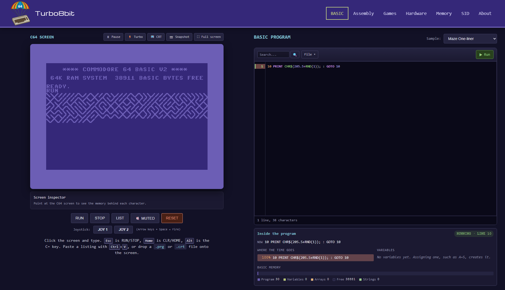

# Turbo8bit

Learn about the Commodore 64 by coding in BASIC and 6502 assembler. A C64
emulator written from scratch in JavaScript, wrapped in a site that explains the
machine it is emulating.

Live at [turbo8bit.com](https://turbo8bit.com).



## Pages

| Route | What it does |
|-------|--------------|
| `/` | BASIC lab — type into a live C64 or write BASIC in the editor; a sample gallery, a live view of the running program, a screen inspector, and save/share/download |
| `/asm` | Assembly lab — assemble 6502, run or single-step it, and watch registers, flags, cycles and memory change |
| `/games` | Games — five complete games written in 6502 assembly, in the style of Space Invaders, Boulder Dash, Giana Sisters, R-Type and International Karate. Play them with the keyboard as a joystick, then read, change and rerun their source in the Assembly lab's editor |
| `/hardware` | Bus simulator — replays real bus traffic recorded from the emulator (boot, keyboard scan, VIC-II fetches, SID writes), plus a chip reference |
| `/memmap` | Memory map explorer — see how banking maps ROM, RAM and I/O into the same 64KB |
| `/sid` | SID player — play SID tunes (or your own `.sid`) with voice, note, oscilloscope, filter and register views, and mute/solo per voice |
| `/about` | What the site is and who made it |

These seven come from `SITE_PAGES` in [web/main.py](web/main.py), which also drives
the nav and `sitemap.xml`. `/robots.txt`, `/sitemap.xml` and `/auth/*` are served
alongside them.

### Using the labs

- Focus the C64 screen to use the emulated keyboard. Search fields, sample
  selectors and other page controls retain their normal keyboard behavior.
  **Ctrl+V** on the screen types the clipboard into the C64.
- A standard gamepad can use the selected joystick port: choose **JOY 1** or
  **JOY 2** in the BASIC lab, or play a game (joystick 2). Press a controller
  button to connect, then focus the C64 screen. The d-pad or left stick moves
  and any face button fires. Controls release when the screen loses focus, the
  tab is hidden, the controller disconnects, or the C64 resets or stops.
- The screen toolbar pauses, runs in **Turbo**, adds a **CRT** look, saves a
  snapshot and goes full screen. Pointing at the screen shows the **inspector**:
  the character's screen and colour RAM addresses, the POKEs that change it, an
  enlarged glyph, and the sprite X/Y of that spot.
- Programs submitted during startup wait for the real BASIC `READY.` prompt;
  resetting cancels pending loads and synthetic typing.
- Slow sample requests cannot overwrite a newer selection or edits made while
  the sample is loading.
- The BASIC editor runs the text currently in the editor, including edits to
  direct-mode examples. Numbered programs load on a freshly reset C64; the
  screen's **RUN** reruns the existing program without resetting. Direct-mode
  commands retain the current machine state. Like the C64's own editor, lines
  are sorted, a repeated line number replaces the earlier line, and a bare
  number deletes it. `{CLR}`, `{RED}`, `{RVS ON}`, `{3 DOWN}` and `{147}` inside
  strings become PETSCII control codes.
- Errors are marked in the editor gutter (with the message on hover) and in its
  status bar; the Assembly editor checks as you type.
- Each editor's **File** menu opens `.bas`/`.asm`/`.txt` (and BASIC `.prg`, which
  is listed back to text), saves the source or a runnable `.prg`, and copies a
  share link that carries the whole program in the URL fragment. Edits are kept
  as a draft in localStorage and restored on the next visit.
- Dropping a BASIC `.prg` on the screen loads it like `LOAD` (setting the
  variable pointers past it) and types `RUN`; machine code is loaded and its
  `SYS` address shown.
- Assembly **Stop** returns to BASIC with a cold reset, so it also recovers from
  halted CPUs, disabled interrupts and banked-out ROM. This clears emulated RAM
  and ejects cartridges, but preserves the editor source. A program's normal
  `RTS` does not reset the machine, and one that ends with `BRK` is noticed
  too. **Pause** a running program and **Step** continues from wherever it is;
  the memory viewer highlights the bytes each step changed.
- The **Games** page is the Assembly lab with its own library. The arrow keys
  and Space are joystick 2, and each run (the editor's **Run**, or **Play** on
  a game's card) starts on a freshly reset C64, booted at turbo speed, and
  turns the sound on unless you have already chosen with the sound button.
  On both assembly pages, loading a sample or game asks first if it would
  replace code you have changed.
- The BASIC page's **sample gallery** shows every sample with a preview
  recorded on this emulator (stills when reduced motion is preferred);
  choosing one loads and runs it, asking first if it would replace code you
  have written. **Play the demo reel** runs the graphics samples in turn until
  you take over by typing, editing or pressing a control.
- **Inside the program**, under the BASIC editor, reads BASIC's own bookkeeping
  while a program runs: the line it is on (marked in the editor gutter), where
  the running time goes (a per-line profile that also glows in the gutter), the
  variables and arrays decoded from memory, and how BASIC has divided its
  memory between program, variables, arrays, free space and strings.
- Sound starts muted. If an audio device or song cannot be opened, the controls
  stay consistent with the actual playback state and show an error.

The Memory explorer follows all 32 CPU/cartridge banking configurations,
including unmapped Ultimax regions. Its cells can be inspected with keyboard
focus and Enter; keys **1**, **2** and **3** toggle LORAM, HIRAM and CHAREN.
Narrow screens scroll the table rather than collapsing its address columns.
Decorative 3D chips pause offscreen and respect reduced-motion preferences.

Memory annotations are generated from the OCR-derived
[memory-map.txt](memory-map.txt) by [parse_memmap.py](tools/parse_memmap.py).
The parser validates address ranges and decimal/hex agreement. Ambiguous
headers are reported and omitted rather than assigned guessed addresses;
the source still has unresolved JMPER and MEMSIZ headers.

## Quick start

Requires Python 3.13 (production runs App Engine's `python313` runtime) and
PowerShell.

```powershell
python -m venv .venv
.\.venv\Scripts\Activate.ps1
pip install -r web\requirements.txt
pip install pytest py_mini_racer pillow

.\dd.ps1 run     # http://localhost:8082
```

`dd.ps1` is the entry point for everything:

| Command | Description |
|---------|-------------|
| `.\dd.ps1 run` | Local dev server on http://localhost:8082 |
| `.\dd.ps1 test` | Run the test suite (pytest) |
| `.\dd.ps1 format` | Format Python with Black (`-Check` reports instead of rewriting) |
| `.\dd.ps1 gen` | Regenerate the header logo, favicons and social image from `raw-images/favicon.png`, and re-record the BASIC sample previews |
| `.\dd.ps1 crt` | Publish CRT cartridge files to Cloud Storage |
| `.\dd.ps1 deploy` | Deploy to Google App Engine (`-NoPromote`, `-Version <ver>`) |
| `.\dd.ps1 help` | Show all commands |

Sign-in and session cookies need secrets. Copy `web/secrets.example.yaml` to
`web/secrets.yaml` and fill it in — the file is git-ignored, `app.yaml` pulls it
in via `includes:`, and `deploy` refuses to run without it.

## Emulator architecture

```
C64Emulator (emulator.js)          SIDPlayer (sid-player.js)
  canvas + Web Audio + keyboard      Web Audio + tune visualisation
                    └────────┬────────┘
                             ▼
                  C64Machine (machine.js)
                  the bus: read(addr) / write(addr, val)
    ├── MOS6510      6502/6510 CPU with per-instruction cycle counts
    ├── VIC-II       scanline renderer, all 5 display modes, sprites
    ├── SID          MOS6581/MOS8580 with DAC, filter and ADSR modelling
    ├── CIA1/CIA2    timers, IRQ/NMI lines, keyboard matrix, joysticks
    ├── 64KB RAM     with $01 banking
    └── ROM/IO       BASIC $A000, KERNAL $E000, Char ROM, I/O $D000-$DFFF
```

Everything the CPU touches goes through `C64Machine.read`/`.write`, so banking,
I/O and cartridge mapping are decided in exactly one place.
Physical RAM is separate from I/O registers and color RAM, so storing beneath
banked-out I/O does not change the hardware. Debugger memory views use `peek`
to preserve read-sensitive interrupt and collision latches.

### Modules

| Module | Purpose |
|--------|---------|
| `emulator.js` | `C64Emulator` — canvas rendering, Web Audio, keyboard, drag-and-drop. Entry point for `/`, `/asm` and `/games` |
| `sid-player.js` | `SIDPlayer` and PSID/RSID parsing. Entry point for `/sid` |
| `machine.js` | `C64Machine` — the bus, banking, CIA timers, keyboard matrix, frame loop |
| `mos6510.js` | The CPU. All 256 opcodes including the undocumented ones |
| `vic-ii.js` | Scanline graphics renderer and sprites |
| `sid.js` | SID chip, DAC modelling and resampling |
| `voice.js` / `filter.js` | Oscillators, ADSR envelopes, and the 6581/8580 filters |
| `psid-driver.js` | The small 6502 driver that runs a SID tune's init/play routines |
| `cartridge.js` | CRT format and bank switching |
| `assembler.js` | 6502 assembler and disassembler |
| `basic-tokenizer.js` | BASIC V2 tokenizer and syntax highlighting |
| `debugger.js` | Stepping, breakpoints and memory inspection |
| `editor.js` | Syntax-highlighted code editor |
| `roms.js` | BASIC, KERNAL and character ROM data |

Page tools outside the emulator folder build on it without changing it:

| Module | Purpose |
|--------|---------|
| `lab/screen-tools.js` | Pause, turbo, CRT, snapshot, full screen, paste, and the screen inspector |
| `lab/memory-viewer.js` | The Assembly page's live hex dump |
| `lab/program-files.js`, `lab/files.js` | File menu, drafts and share links |
| `lab/basic-monitor.js` | Reads BASIC's state from memory: running line, variables, arrays, memory layout |
| `lab/program-view.js` | The BASIC page's live program view and line profiler |
| `lab/sample-gallery.js` | The BASIC page's sample gallery and demo reel |
| `bus-trace.js` | Records real bus accesses for the hardware page's diagram |

The gallery's previews in `web/static/basic/previews/` are recorded by
[gen_sample_previews.py](tools/gen_sample_previews.py), which runs each sample
on the emulator (scripting a short session for the ones that wait for input)
and keeps border and background flashes under three a second. Re-record after
changing a sample with `.\dd.ps1 gen`, or
`python tools/gen_sample_previews.py <id>` for just one.

The assembler accepts labels with or without a colon (in column one), `ORG` or
`*=`, `NAME = value` / `EQU` constants, expressions with `$hex`, `%binary`,
`'c'`, `*` (current address), `+ - * /`, parentheses and `<`/`>` byte selection,
and `BYTE`/`WORD`/`TEXT`/`ASCIIZ` data (also as `.byte` or ACME's `!byte`).
Quoted text is stored as PETSCII as typed on a C64.

The games in `web/static/games/` are one self-contained `.asm` file each,
listed in its `index.json` along with the text of the page's game cards. They
share a shape, so reading one helps with the rest: code from `$0810`
(`SYS 2064`), the ROM font copied to `$3800` with the game's own characters
after it, a raster interrupt that paces a main loop at 50 frames a second, a
table-driven sound effects player (Jumpin' Jo, Nova Strike and Dojo Duel keep
it on voice 3 and play two-voice music on the others), and the settings to
play with as constants at the top. The comments at the top of each file explain what to
look for and what to try changing.

## What the emulator covers

**CPU** — all 151 documented opcodes plus the undocumented ones (LAX, SAX, DCP,
ISB, SLO, RLA, SRE, RRA, ANC, ALR, ARR, SBX, LXA, LAS, ANE, SHA/SHX/SHY/TAS and
the JAM opcodes), with per-instruction cycle counts including page-crossing
penalties, BCD arithmetic, and the `JMP ($xxFF)` page-wrap bug.

**VIC-II** — rendered a scanline at a time, so raster interrupts can change
registers mid-frame and split-screen effects work. All five display modes
(standard and multicolor character, standard and multicolor bitmap, extended
background colour), 8 hardware sprites with multicolor, X/Y expansion, priority
and collision latches, plus smooth scrolling (each text row starts on its Bad
Line), 24-row and 38-column border masking, screen blanking with DEN, VIC bank
selection and Bad Line CPU stalling. The border hides sprites without stopping
their collisions, and unconnected register bits read as 1 (so `PEEK(53280)` is
254 after start-up, as on a real C64).

**SID** — 6581 and 8580 waveform generation with combined-waveform tables and
noise-register writeback, ADSR envelopes (including the 8-bit counter wrap some
players trip), ring modulation and oscillator sync, and non-linear waveform and
envelope DACs. The filter, mixer and DC levels follow reSID 0.16's linear model:
each chip's measured cutoff curve, resonance that peaks at the cutoff without
cutting the passband, and the 6581's DC offsets, which are what make
volume-register (`$D418`) samples audible. The C64's output stage follows, then
a two-stage windowed-sinc resampler brings the 1 MHz stream to the audio rate
without folding ultrasonic harmonics back into it, and a soft limiter catches
rare peaks. libsidplayfp's non-linear 6581 op-amp filter is not modelled.
Register writes are timestamped by CPU cycle and applied at the right point in
the sample stream.
Both audio frontends consume interleaved machine frames. The SID player retains
unused frame samples between output requests, and validates tune metadata,
payload bounds and driver relocation space before replacing the current tune.

**CIA** — Timer A/B on both chips in one-shot and continuous modes, Timer B
counting Timer A underflows, IRQ from CIA1 and NMI from CIA2 (used by digi
playback), the 8×8 keyboard matrix scanned in both directions, and two joysticks.

**Cartridges** — the CRT container format (CCS64/VICE), with bank switching
through the `$DE00-$DFFF` I/O window for the common hardware types (Normal,
Ocean, Action Replay, Final Cartridge III, EasyFlash and others) and EXROM/GAME
line handling for 8K, 16K and Ultimax modes. Drop a `.crt` or `.prg` onto the
emulator screen to load it.

Timing is accurate per instruction rather than per cycle: the CPU runs whole
instructions and the VIC-II steals a flat 40 cycles on a Bad Line, so effects
that depend on sub-instruction bus timing or sprite DMA will not be exact.

## Testing

Tests run the emulator's JavaScript inside Python using
[py_mini_racer](https://github.com/bpcreech/PyMiniRacer), so the CPU, SID, VIC-II
and cartridge code are all covered without a browser.

```powershell
.\dd.ps1 test
```

Some cartridge tests skip unless the matching CRT dump is present locally — CRT
files live in Cloud Storage rather than in the repo.

Current baseline: **730 passed, 25 skipped, 0 failed** (755 collected), with no
unchecked boolean-return test warnings.

The suite also covers browser-wrapper audio/input/lifecycle behavior using
small DOM and Web Audio substitutes, fresh-boot loading against the real
machine, sample-selection races, SID page error/retry paths, and Flask routes.
Every BASIC sample is run on the emulated C64 and must finish without a BASIC
error, and must have a description and recorded previews; every game must
assemble, take over the interrupt, and still be running after fire starts it; the program view's
decoding is checked against what BASIC's own `PRINT` shows; and the hardware
page's traces are checked against what the KERNAL really does.
These tests need no browser or extra frontend dependencies. Real-browser checks
remain important for native keyboard/undo behavior and responsive layout.
When changing the lab layout, check a 300-line program at desktop and phone
widths: the editor should scroll internally and never overlap the reference
section or stretch the entire workspace to the source's height.
Check validation feedback too: wrapped mobile controls must not clip the status
row below the code area.

## License

MIT
